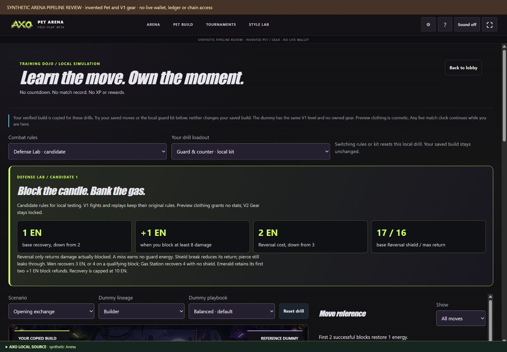
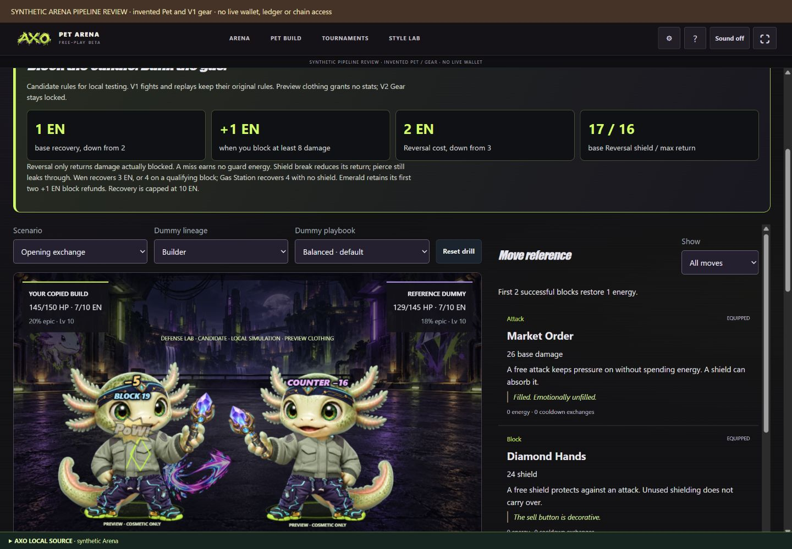
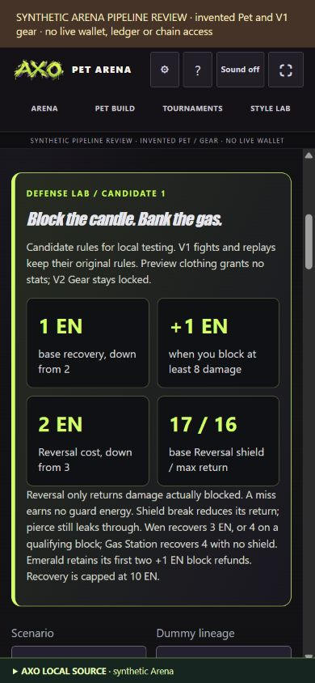

# AXO-023 defense and energy review

Scope: actual numeric candidate mechanics in a local selectable Dojo, with full-fight comparison against current V1. Source checks and synthetic browser evidence are distinct from live-host or player acceptance.

| Domain | Reviewed result | Evidence / limit |
| --- | --- | --- |
| Block usefulness | Qualifying blocks earn +1 EN; empty shields earn none | Exact seven/eight threshold tests; pierce/strip actual-block tests |
| Counter payoff | 2 EN cost, 17 base shield, return up to 16 actual blocked | Hit/whiff/cap/cooldown/mastery tests |
| Energy pressure | Free pressure gains only 1 EN; Wen/refuel have distinct opportunities | Zero/cap/refund receipt tests; scarcity 5.2 → 19.3% in finite suite |
| Duration / stalls | Mean 7.53 exchanges; none at 14 limit in audit | Pure guard loop also terminates under Liquidation |
| Lineages / gear | All lineages, three levels, capped equal V1 gear compared | Rose remains weak in this policy suite; asymmetric/mastery/human acceptance pending |
| Recovery strategy | Correct conditional Wen and guaranteed Gas Station recovery | Short-horizon policies never choose Wen; longer-horizon review needed |
| Historical compatibility | No V1 catalog/combat/replay/service edits | Candidate version rejected by V1 replay; candidate request rejected by HTTP |
| Ownership / exact XP | Canonical validation retained, dummy owns zero gear | Unit/DOM tests preserve exact XP/stats/service DB; previews have no power |
| UI integration | Rules/kit reset; actual reference/comparison/step dispatch and energy receipt | DOM test; browser read 6−2+1+1+1=7 EN for Emerald counter |
| Fitted art / masks | Existing rig and contact inspector reused unchanged | Browser held counter contact; no actor/geometry/art changes |
| Narrow screens | Controls wrap, no horizontal page/main overflow at 390 and 320 px | Browser measurements/screenshots; physical-device acceptance pending |
| Performance / privacy | Local bounded legal-reply comparisons, no new server evaluator or telemetry | No match/XP/gear POST or persistent candidate store; physical profiling pending |
| AXO operations | Source handoff and rollback documented | Host source, AXO acknowledgment and live integration UNKNOWN |

`npm run check` (includes `test:dev`): PASS, 465 tests (260 Arena including arena-engine, 41 contracts, 14 source-preview). Offline audit asserts mirror parity, legal choices, integer bounded energy, returned damage bounded by blocked damage, exact XP and coarse duration/limit/choice regression gates. Source hashes cover catalog, historical resolver and candidate resolver.

Browser: synthetic 17,950-XP level-10 Pet, eight invented verified V1 items, fitted cosmetic Preview. Tested V1 default → candidate → local guard kit → Reversal against Market Order, response comparison, reset/rules switch and narrow controls. Sound remained off. No real wallet, chain, player ledger or device-performance claim.

Remaining acceptance: [mechanics guide](../ARENA_DEFENSE_ENERGY.md#balance-evidence) and [AXO-023](../handoffs/AXO-023.md). A published file is not an AXO acknowledgment or deployment.
