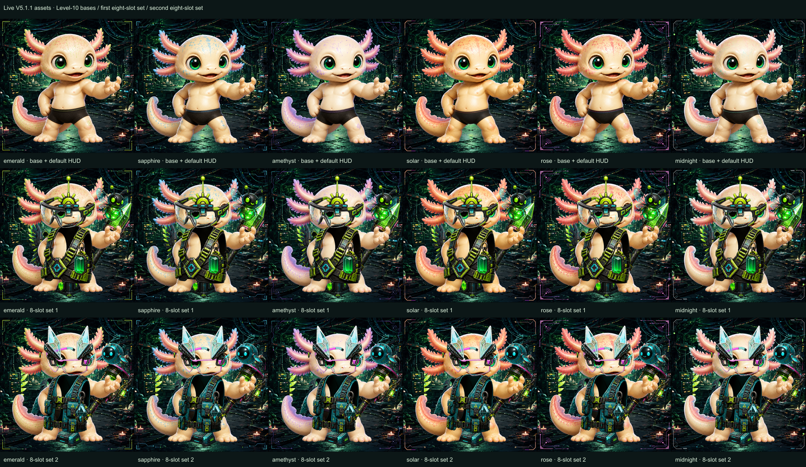
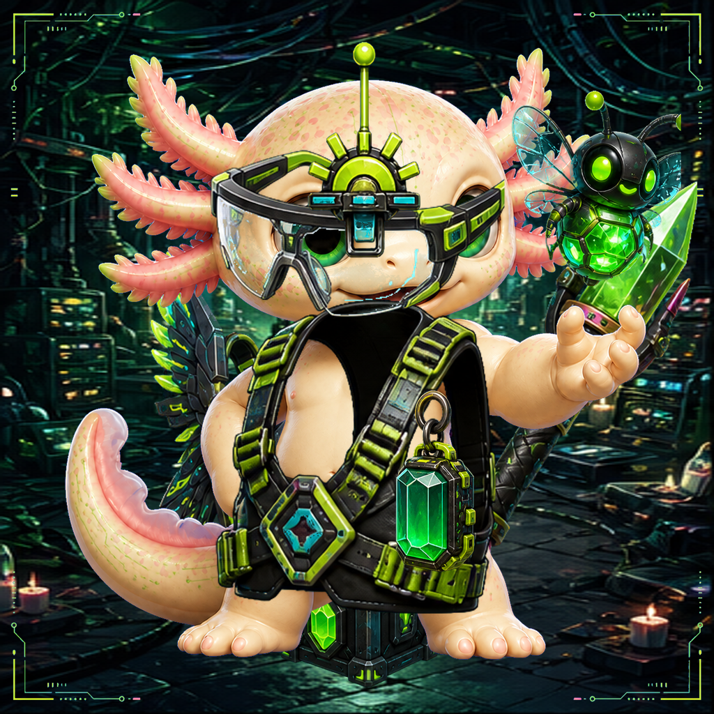

# Level-10 Gear fit review — 2026-10-18

Source: the checked-in V5.1.1 visual catalog and public artwork read from https://axo.pet.
Status: **FAILED VISUAL FIT REVIEW** following operator review of the assembled outfits.
This is static wardrobe inspection, not live ownership verification or release approval.

## Evidence

- 69 canonical assets checked: six Level-10 bases, six lineage HUDs, one background and all 56 launch Gear layers.
- Every downloaded byte hash matches its catalog runtime hash; dimensions are 1024 × 1024, color space is sRGB and all non-background layers have alpha.
- Rendered 336 single-item combinations: all 56 launch items on each of six lineages, using the canonical z-order.
- Rendered 12 eight-slot loadouts (the first and second item in each slot, on each lineage), plus six undressed baselines.
- Six full-size dressed results match the existing `renderV5GearComposite` output pixel-for-pixel after decoding.
- Inspected the overview and all eight slot contact sheets; inspected the first Emerald full loadout at 1024 × 1024.



## Visible fit assessment

The operator correctly identified perspective and masking defects in the assembled outfits. The initial contact-sheet assessment was too generous: common canvas dimensions, matching hashes and compositor parity do not establish a good fit. The output can faithfully reproduce the existing renderer while still being visually wrong.

The flat vest collars/chest panels do not convincingly wrap the base Pet's neck, shoulders and torso. Head/face hardware needs matched perspective and explicit depth relationships. A single flat image per Gear slot with only global z-order cannot represent every necessary behind/in-front boundary around neck, cheek, gills, arms and fingers.

Required repair and review:

- Author a fitted body-layer candidate against the exact canonical base; use true transparent openings and matched perspective instead of opaque stand-in interior surfaces.
- Define explicit front/rear Gear pieces and protected base occluders for chin/neck, gills, arms and fingers. Headwear and visor hardware also stack densely over the eye area; 1001/2001 and 1002/2002 are pairwise review targets.
- Back items sit behind the Pet by design, and some habitat items are mostly obscured between the feet or by the suit. Their visibility varies with the busy background and other slots.
- The contact sheets cover each launch item individually and two full outfits, not every possible multi-slot combination. Wider compatibility approval still needs deliberate pairwise/full-outfit art review.



The dressed Arena uses this fixed adult stack with bounded fighter transforms. Its geometry/masks need correction before visual approval. Pose-specific animated Gear, every combat pose and mobile in-game visibility remain outside this static review. The current canonical artwork is not approved by this report.

## Reproduce

Use a public asset directory whose files match the checked-in catalog, then run:

```sh
node scripts/review-gear-fit.mjs --assets <public-asset-root> --out <review-output-directory>
```

The tool rejects missing, mismatched, incorrectly sized or non-alpha assets, generates per-slot sheets and compares full composites with the existing visual engine. It leaves source artwork unchanged and does not access player state. Generated sheets and summary outside this small checked-in evidence set are review outputs, not production runtime assets.
